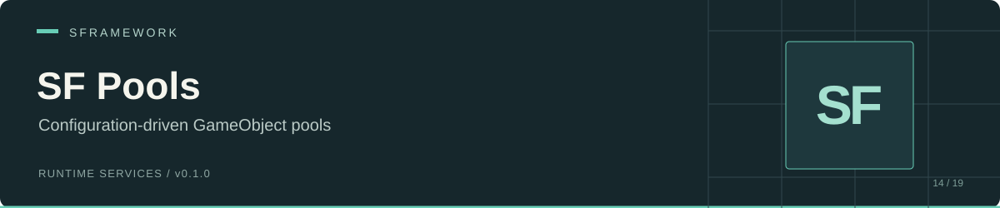

# SF Pools

 

SF Pools loads config-defined Addressable prefabs and reuses their instances through Unity's `ObjectPool<GameObject>`. Spawned instances receive a position and rotation; despawning deactivates them for reuse.

Use it for repeated objects such as projectiles, effects, or scene props when your application can manage loading, reset behavior, and cleanup.

[Install](#install) · [Configure](#configure) · [Use](#use) · [API](#api) · [Limitations](#limitations)

## Install

In Unity Package Manager, select **Add package from git URL** and enter:

```text
https://github.com/huran438/sf-pools.git#main
```

The [manifest](package.json) does not declare dependencies. Install these separately:

| Requirement | Reason |
| --- | --- |
| [SF Core](https://github.com/huran438/sf-core) | Service registration and injection helpers. |
| [SF Configs](https://github.com/huran438/sf-configs) | Prefab config tree and asset/ID attributes. |
| [SF Debug](https://github.com/huran438/sf-debug) | Assembly dependency of SF Core. |
| [UniTask](https://github.com/Cysharp/UniTask) | `Load` and service initialization. |
| Unity Addressables (`com.unity.addressables`) | Addressable prefab loading and ResourceManager assemblies. |
| Newtonsoft.Json | SF Configs references `Newtonsoft.Json.dll`. |
| Unity editor with `UnityEngine.Pool` | The implementation uses `ObjectPool<GameObject>` and `IObjectPool<GameObject>`. |

Your code assembly must reference `SFramework.Pools.Runtime` and the SF assemblies it uses. `package.json` lists Unity `2019.4`; that metadata does not establish compatibility with the pool API, newer C# syntax, or SF Core's `destroyCancellationToken` usage. No supported editor floor was verified here.

## Configure

Save this as a JSON TextAsset under a `Resources` folder, for example `Assets/Resources/SFramework/Pools.json`:

```json
{
  "Type": "SFPoolsConfig",
  "Id": "pools",
  "Version": 1,
  "Groups": [{
    "Id": "combat",
    "Prefabs": [{
      "Id": "projectile",
      "Path": "Prefabs/Projectile",
      "PreloadAmount": 0
    }]
  }]
}
```

Keep `Type` first because SF Configs identifies JSON by its first or last property. Mark your prefab Addressable with the address `Prefabs/Projectile`. The runtime calls Addressables for `Path`; placing a prefab in `Resources` alone does not provide an Addressables key.

The config tree produces `pools/combat/projectile`. Use the complete `config/group/prefab` ID in service calls. `[SFPrefab]` supplies an inspector ID selector for `SFPoolsConfig`.

| Field | Runtime use |
| --- | --- |
| `SFPoolsConfig.Groups` | Groups to inspect during initialization. |
| `SFPrefabsGroupNode.Prefabs` | Configured prefab nodes. |
| `SFPrefabNode.Path` | Addressables key for the prefab. |
| `SFPrefabNode.PreloadAmount` | Exposed config field; the service does not read it. |

Register configs before pools. SF Core constructs services during `Bind`, then awaits service initialization in registration order.

## Use

Save this class as `PoolsContext.cs` and add it to your startup scene. For this example, the default SF Configs service must load only `SFPoolsConfig` JSON; see the mixed-config limitation below.

```csharp
using System.Threading;
using Cysharp.Threading.Tasks;
using SFramework.Configs.Runtime;
using SFramework.Core.Runtime;
using SFramework.Pools.Runtime;
using UnityEngine;

public sealed class PoolsContext : SFContextRoot
{
    private ISFPoolsService _pools;
    private GameObject _projectile;

    protected override void PreInit() { }

    protected override void Bind()
    {
        SFContainer.Register<ISFConfigsService, SFConfigsService>();
        _pools = SFContainer.Register<ISFPoolsService, SFPoolsService>();
    }

    protected override async UniTask Init(CancellationToken cancellationToken)
    {
        const string id = "pools/combat/projectile";
        await _pools.Load(id);
        if (_pools.Spawn(id, out _projectile, Vector3.zero, Quaternion.identity))
            Debug.Log("Projectile spawned.");
    }

    public void ReturnProjectile()
    {
        if (_projectile != null && _pools.Despawn(_projectile))
            _projectile = null;
    }
}
```

`Init` indexes config nodes; it does not load prefabs. Await `Load` once before spawning from a pool. On reuse, reset gameplay state such as velocity, timers, health, and event subscriptions in your own component lifecycle.

The pool creates instances with `Object.Instantiate`, activates them on `Get`, and deactivates them on `Release`. `Spawn` assigns position and rotation after `Get`, so `OnEnable` can run before the new transform values reach the object.

## API

The [interface](Runtime/ISFPoolsService.cs) extends `ISFService`, including `UniTask Init(CancellationToken cancellationToken)` and `void Dispose()`.

| Signature | Behavior |
| --- | --- |
| `bool CanSpawnPrefab(string prefab)` | Checks whether the prefab asset has loaded; does not enforce pool capacity. |
| `UniTask Load(string prefab, IProgress<float> progress = null, CancellationToken cancellationToken = default)` | Loads the configured asset and creates its pool. Current code ignores progress and cancellation. |
| `void Unload(string prefab)` | Throws `NotImplementedException`. |
| `bool Spawn(string prefab, out GameObject gameObject, Vector3 position, Quaternion rotation)` | Returns `false` and `null` when the pool does not exist. |
| `bool Spawn<T>(string prefab, out T component, Vector3 position, Quaternion rotation) where T : Component` | Spawns, then calls `GetComponent<T>()`. Success does not guarantee a non-null component. |
| `bool Despawn(GameObject gameObject)` | Returns an active tracked instance to its pool; returns `false` for inactive or untracked objects. |
| `void DespawnAll()` | Attempts to release tracked instances. |

Pass a live, non-null GameObject to `Despawn`. Use the generic spawn overload when the prefab root carries the requested component, and check the returned component before using it.

## Limitations

- `SFPoolsService.Init` calls the obsolete `ISFConfigsService.GetConfigs<SFPoolsConfig>()`. In the current SF Configs implementation, that method casts the entire config collection instead of filtering it. Loading JSON for other config types can throw `InvalidCastException`. Supply a type-filtering `ISFConfigsService` implementation or address that integration issue before combining config modules.
- Unknown IDs in `Load` throw through dictionary lookup. Repeated `Load` calls replace the pool without disposing the previous one; the service does not coordinate concurrent loads.
- `Load` releases its Addressables asset handle after creating the pool, while retaining the prefab reference for future instantiation. The service does not maintain an Addressables lifetime reference for the pool. Validate asset and dependency lifetimes before relying on this behavior.
- `Unload` has no implementation. `Dispose` does not clear pools, destroy active instances, or release retained resources. The service exposes no capacity, prewarm, reset, parent, or pool statistics controls.
- New instances call the core `Inject(this object)` extension on the GameObject. That extension uses object injection and does not traverse child components. `SFView` components inject themselves in `Awake`; plain `ISFInjectable` components need an explicit integration path such as `SFContainer.Inject(gameObject, includeInactive: true)`.
- `DespawnAll` iterates the tracking dictionary. Pool destruction removes entries from that dictionary; a release that triggers destruction can invalidate the enumeration.

For `Spawn` returning `false`, check the full ID and await `Load` first. For a `true` generic spawn with a null component, verify that the requested component sits on the prefab root. An object you deactivate yourself cannot pass the current `Despawn` active-state check.

## Source and related modules

[Service](Runtime/SFPoolsService.cs) · [Config](Runtime/SFPoolsConfig.cs) · [Prefab node](Runtime/SFPrefabNode.cs) · [Assembly](Runtime/SFramework.Pools.Runtime.asmdef)

[SF Core](https://github.com/huran438/sf-core) provides service registration; [SF Configs](https://github.com/huran438/sf-configs) provides IDs and JSON loading; [SF Scenes](https://github.com/huran438/sf-scenes) loads additive scenes.

Documentation reflects source snapshot `d5145f094d4002c5630c6ed4d853d4b315936cf4`. API and dependency checks were static; no Unity compile, play-mode run, pooling benchmark, or Addressables build was performed.

## License

MIT. See [LICENSE.md](LICENSE.md) for the terms.
