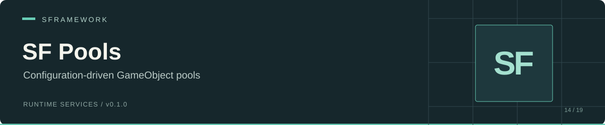

# SF Pools

 

## Overview

SF Pools loads config-defined Addressable prefabs and reuses their instances through Unity's `ObjectPool<GameObject>`. Spawned instances receive a position and rotation; despawning deactivates them for reuse.

Use it for repeated objects such as projectiles, effects, or scene props. The service owns the loaded prefab and its clones; your application controls when to load them and how to reset gameplay state.

## Requirements

See the [manifest](package.json) for declared dependencies. The host project must provide these assemblies:

| Requirement | Reason |
| --- | --- |
| [SF Core](https://github.com/huran438/sf-core) | Service registration and injection helpers. |
| [SF Configs](https://github.com/huran438/sf-configs) | Prefab config tree and asset/ID attributes. |
| [SF Debug](https://github.com/huran438/sf-debug) | Assembly dependency of SF Core. |
| [UniTask](https://github.com/Cysharp/UniTask) | `Load` and service initialization. |
| Unity Addressables (`com.unity.addressables`) | Addressable prefab loading and ResourceManager assemblies. |
| Newtonsoft.Json | SF Configs references `Newtonsoft.Json.dll`. |
| Unity editor with `UnityEngine.Pool` | The implementation uses `ObjectPool<GameObject>` and `IObjectPool<GameObject>`. |

Your code assembly must reference `SFramework.Pools.Runtime` and the SF assemblies it uses. Use Unity 6000.0 or later.

This package has no package-specific scripting define requirement.

## Installation

In Unity Package Manager, select **Add package from git URL** and enter:

```text
https://github.com/huran438/sf-pools.git#main
```

## Quick start

### Configuration

Save this as a JSON TextAsset under a `Resources` folder, for example `Assets/Resources/SFramework/Pools.json`:

```json
{
  "Type": "SFPoolsConfig",
  "Id": "pools",
  "Version": 1,
  "Groups": [{
    "Id": "combat",
    "Prefabs": [{
      "Id": "projectile",
      "Path": "Prefabs/Projectile",
      "PreloadAmount": 0
    }]
  }]
}
```

Keep `Type` first because SF Configs identifies JSON by its first or last property. Mark your prefab Addressable with the address `Prefabs/Projectile`. The runtime calls Addressables for `Path`; placing a prefab in `Resources` alone does not provide an Addressables key.

The config tree produces `pools/combat/projectile`. Use the complete `config/group/prefab` ID in service calls. `[SFPrefab]` supplies an inspector ID selector for `SFPoolsConfig`.

| Field | Runtime use |
| --- | --- |
| `SFPoolsConfig.Groups` | Groups to inspect during initialization. |
| `SFPrefabsGroupNode.Prefabs` | Configured prefab nodes. |
| `SFPrefabNode.Path` | Addressables key for the prefab. |
| `SFPrefabNode.PreloadAmount` | Exposed config field; the service does not read it. |

Register configs before pools. SF Core constructs services during `Bind`, then awaits service initialization in registration order.

### Usage

Save this class as `PoolsContext.cs` and add it to your startup scene. Pools indexes only `SFPoolsConfig` entries, so other config types can share the same Configs service.

```csharp
using System.Threading;
using Cysharp.Threading.Tasks;
using SFramework.Configs.Runtime;
using SFramework.Core.Runtime;
using SFramework.Pools.Runtime;
using UnityEngine;

public sealed class PoolsContext : SFContextRoot
{
    private const string ProjectileId = "pools/combat/projectile";
    private ISFPoolsService _pools;
    private GameObject _projectile;

    protected override void PreInit() { }

    protected override void Bind()
    {
        SFContainer.Register<ISFConfigsService, SFConfigsService>();
        _pools = SFContainer.Register<ISFPoolsService, SFPoolsService>();
    }

    protected override async UniTask Init(CancellationToken cancellationToken)
    {
        await _pools.Load(ProjectileId, cancellationToken: cancellationToken);
        if (_pools.Spawn(ProjectileId, out _projectile, Vector3.zero, Quaternion.identity))
            Debug.Log("Projectile spawned.");
    }

    public void ReturnProjectile()
    {
        if (_projectile != null && _pools.Despawn(_projectile))
            _projectile = null;
    }

    private void OnDestroy() => _pools?.Unload(ProjectileId);
}
```

`Init` indexes config nodes; it does not load prefabs. Await `Load` once before spawning from a pool. On reuse, reset gameplay state such as velocity, timers, health, and event subscriptions in your own component lifecycle.

The pool creates instances with `Object.Instantiate`. A prefab saved active can run its first `OnEnable` during instantiation. On reuse, `Spawn` assigns the requested transform before activating the returned object.

## API

The [interface](Runtime/ISFPoolsService.cs) extends `ISFService`, including `UniTask Init(CancellationToken cancellationToken)` and `void Dispose()`.

| Signature | Behavior |
| --- | --- |
| `bool CanSpawnPrefab(string prefab)` | Checks whether the pool is ready for spawns. |
| `UniTask Load(string prefab, IProgress<float> progress = null, CancellationToken cancellationToken = default)` | Loads the configured asset or waits for the existing load. An optional progress callback receives Addressables progress and `1` on success. |
| `void Unload(string prefab)` | Cancels pending waiters, destroys all clones from the pool, and releases its prefab handle. No effect if the ID has no pool or pending load. |
| `bool Spawn(string prefab, out GameObject gameObject, Vector3 position, Quaternion rotation)` | Returns `false` and `null` when the pool does not exist. |
| `bool Spawn<T>(string prefab, out T component, Vector3 position, Quaternion rotation) where T : Component` | Returns a component on the prefab root. If absent, returns the clone to its pool and reports `false` with a null output. |
| `bool Despawn(GameObject gameObject)` | Returns a checked-out instance to its pool, even if the caller disabled it. Untracked and already returned objects are ignored. |
| `void DespawnAll()` | Returns all checked-out instances. |
| `void Dispose()` | Unloads every pool and prevents new loads. |

Pass a live, non-null GameObject to `Despawn`. Use the generic spawn overload when the prefab root carries the requested component, and check the returned component before using it.

## Behavior and limitations

- Use the service on Unity's main thread. Unknown IDs in `Load` throw; a failed Addressables load leaves no pool and can be retried.
- Callers share the same operation. A caller's cancellation token cancels only that caller's wait. Even if every caller cancels, the service can finish the load and keeps the pool until `Unload` or `Dispose`.
- The pool retains its own Addressables handle. In Play Mode, the handle is released after Unity has processed deferred clone destruction. The service exposes no capacity, prewarm, reset, parent, or pool statistics controls.
- New instances inject plain `ISFInjectable` components throughout the hierarchy, including inactive children. `SFView` components are skipped by this traversal because they inject themselves in `Awake`. Reusing a pooled object does not repeat injection; service changes require explicit reinjection.
- Clones belong to the scene where Unity instantiates them. If the service outlives that scene, it skips scene-destroyed instances when reusing or unloading the pool.

## Tests

Package tests are in [Tests/Editor](Tests/Editor) and use the `SFramework.Pools.Editor.Tests` assembly. Install Unity Test Framework (`com.unity.test-framework`) in the host project. Test assemblies are Editor-only and gated by `UNITY_INCLUDE_TESTS`.

Add `sp.sframework.pools` to the top-level `testables` array in the host project's `Packages/manifest.json`, preserving its dependencies and any existing testable entries:

```json
{
  "testables": ["sp.sframework.pools"]
}
```

Open **Window > General > Test Runner**, select **EditMode**, and run `SFramework.Pools.Editor.Tests`. The `sf-demo` host enables all SFramework package tests in its manifest.

The EditMode suite uses controlled Addressables operations to cover load sharing, cancellation, failure and retry, and clone and handle teardown without downloading content. Validate catalogs, gameplay resets, and player builds in the consuming project.

## License

MIT. See [LICENSE.md](LICENSE.md) for the terms.
